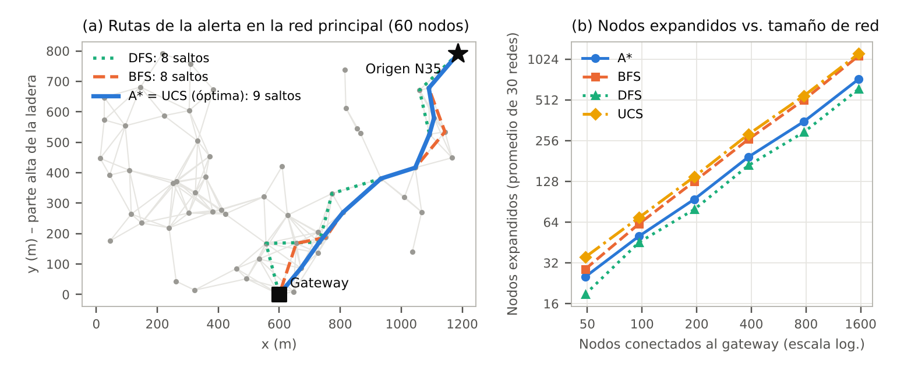

# Enrutamiento y diagnóstico de alertas tempranas en una red Mesh IoT de ladera

Proyecto Integrador del curso **Inteligencia Artificial I (INF DIS C)**, Universidad Militar Nueva Granada, 2026-2.
Autor: **Sebastián Velásquez Osorio** · Docente: Jhon Edwin Vera Vera

Una red de nodos ESP32 que se comunican con ESP-NOW vigila la lluvia, la humedad del suelo y la inclinación del
terreno en una ladera de Usme (Bogotá). Cuando un nodo detecta un evento, su alerta debe llegar al gateway saltando
por otros nodos. El agente racional diseñado en la Fase 1 decide por dónde enviarla. Este repositorio contiene:

- **Fase 2:** el enrutamiento de la alerta formalizado como problema de búsqueda en un espacio de estados y resuelto
  con BFS, DFS, costo uniforme (UCS) y A*, con benchmark y análisis de complejidad.
- **Fase 3:** una base de conocimiento con un motor de encadenamiento hacia adelante (Modus Ponens) que diagnostica
  por qué un nodo dejó de reportar y decide qué hacer.

## Estructura

```
mesh_routing/
  topologia.py        red reproducible (semilla) y costo ETX de cada enlace
  problema.py         formalización del espacio de estados y heurísticas de A*
  busqueda.py         BFS, DFS, UCS y A* instrumentados (expandidos, generados, frontera, tiempo)
experimentos/
  benchmark.py        experimento principal y de escalabilidad  ->  resultados/*.csv
  figura_rutas.py     rutas y curva de nodos expandidos         ->  resultados/figura_rutas.png
fase3/
  motor_inferencia.py base de conocimiento, reglas y encadenamiento hacia adelante
tests/                pruebas unitarias (unittest)
resultados/           datos usados en los informes
```

## Cómo ejecutar

Requiere Python 3.10 o superior. El núcleo usa solo la biblioteca estándar; `matplotlib` solo hace falta para la figura.

```bash
python -m experimentos.benchmark          # tablas de la Fase 2 (unos 10 s)
python -m experimentos.figura_rutas       # figura (pip install matplotlib)
python -m fase3.motor_inferencia          # simulación de la Fase 3
python -m unittest discover -s tests -v   # 12 pruebas
```

Los conteos (nodos expandidos, costo, saltos) son deterministas para una misma semilla; los tiempos dependen del equipo.

## Formalización del problema (Fase 2)

| Componente | Definición |
|---|---|
| Estado | Nodo de la red donde se encuentra el mensaje de alerta |
| Estado inicial | Nodo que detectó el evento (N35, el más lejano del gateway en la red principal) |
| Acciones(s) | Transmitir a un vecino activo de s |
| Modelo de transición | Resultado(s, transmitir(v)) = v (determinista en la abstracción) |
| Prueba de meta | s = GW (gateway) |
| Costo de acción | ETX del enlace: transmisiones esperadas = 1 / (d_f · d_r) (De Couto et al., 2003) |

Heurística de A*: `h(n) = max(techo(d(n,GW)/R) · ETX_min, d(n,GW)/ρ_max)`, donde R es el alcance máximo de un enlace,
ETX_min el menor ETX de la red y ρ_max el mayor avance en metros por transmisión esperada. Es admisible y consistente
(la justificación está en `problema.py` y se verifica en `tests/test_busqueda.py`).

## Resultados (red principal de 60 nodos, semilla 2026, origen N35)

| Algoritmo | Nodos expandidos | Nodos generados | Frontera máx. | Saltos | Costo (ΣETX) | Tiempo (ms) | ¿Óptimo? |
|---|---:|---:|---:|---:|---:|---:|---|
| BFS | 23 | 122 | 9 | 8 | 24.36 | 0.068 | No (+35 %) |
| DFS | 15 | 59 | 12 | 8 | 34.28 | 0.038 | No (+90 %) |
| UCS (A* con h = 0) | 28 | 166 | 15 | 9 | 18.04 | 0.111 | Sí |
| A* | 18 | 103 | 12 | 9 | 18.04 | 0.096 | Sí |

Comparación de heurísticas de A* sobre el mismo problema:

| Heurística | h(N35) | Nodos expandidos | Costo | b* |
|---|---:|---:|---:|---:|
| h = 0 (UCS) | 0.00 | 28 | 18.04 | 1.222 |
| h1 = d/R · ETXmin | 5.85 | 23 | 18.04 | 1.184 |
| h2 = techo(d/R) · ETXmin | 6.42 | 22 | 18.04 | 1.175 |
| h3 = d / rho_max | 11.15 | 18 | 18.04 | 1.136 |
| h = max(h2, h3) | 11.15 | 18 | 18.04 | 1.136 |

Escalabilidad (densidad constante, promedio de 30 redes por tamaño, origen = nodo más lejano):

| Nodos | BFS expandidos | DFS expandidos | UCS expandidos | A* expandidos | Costo BFS / óptimo | Costo DFS / óptimo |
|---:|---:|---:|---:|---:|---:|---:|
| 50 | 28.7 | 18.7 | 35.2 | 25.2 | 1.38 | 1.63 |
| 100 | 62.2 | 45.4 | 69.2 | 50.4 | 1.35 | 1.77 |
| 200 | 127.7 | 79.4 | 138.4 | 94.4 | 1.38 | 2.35 |
| 400 | 262 | 168 | 285.2 | 194.1 | 1.35 | 3.02 |
| 800 | 512.1 | 295.5 | 548.9 | 354.1 | 1.38 | 3.42 |
| 1600 | 1082.9 | 615.9 | 1123.5 | 729 | 1.43 | 4.01 |



## Fase 3: motor de reglas

`fase3/motor_inferencia.py` define 8 proposiciones observables, 9 reglas de Horn y el caso de entrada del nodo N10
(silencioso en una noche de lluvia fuerte). El encadenamiento hacia adelante concluye: emitir alerta temprana,
recalcular rutas sin N10 (con el A* de la Fase 2), aumentar la potencia de los vecinos e inspeccionar el nodo.

## Referencias

- De Couto, D. S. J., Aguayo, D., Bicket, J. y Morris, R. (2003). A high-throughput path metric for multi-hop wireless routing. *MobiCom '03*, 134–146. https://doi.org/10.1145/938985.939000
- Hart, P. E., Nilsson, N. J. y Raphael, B. (1968). A formal basis for the heuristic determination of minimum cost paths. *IEEE Transactions on Systems Science and Cybernetics, 4*(2), 100–107. https://doi.org/10.1109/TSSC.1968.300136
- Russell, S. y Norvig, P. (2021). *Artificial intelligence: A modern approach* (4.ª ed.). Pearson.
- AIMA-Python: https://github.com/aimacode/aima-python

Licencia MIT.
